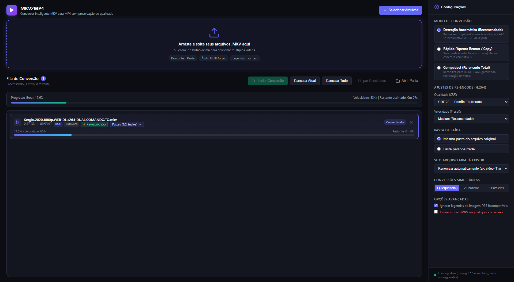

# mkv2mp4 — Conversor de Vídeos Ultra-Rápido

[](https://github.com/diogold01/mkv2mp4/releases)
[](https://github.com/diogold01/mkv2mp4/releases)
[](LICENSE)

> Aplicação desktop para Windows focada na conversão ágil e inteligente de contêineres MKV para MP4, com suporte a remux sem perda de qualidade, suporte a Dual Áudio com seleção de faixas, re-encode seletivo e interface moderna em tema escuro.

---

## 📸 Demonstração da Interface



---

## 🚀 Principais Recursos

- **Remux Sem Perda de Qualidade (Ultra-Rápido):** Converte contêineres MKV para MP4 em segundos via `-c copy` quando os codecs forem compatíveis (H.264/H.265 + AAC/AC3/MP3).
- **🎛️ Suporte a Dual Áudio e Seleção de Faixas:**
  - Inspeciona todas as faixas de áudio e legendas de cada arquivo MKV via FFprobe.
  - Permite escolher exatamente quais faixas de áudio manter (ideal para remover a faixa em inglês ou japonês de vídeos Dual Áudio e manter apenas o áudio dublado, ou vice-versa).
  - **Otimização Remux Turbo:** Se o arquivo tiver um áudio DTS e um áudio AAC, ao desmarcar o áudio DTS o aplicativo promove automaticamente a conversão para Remux direto (`-c copy`) instantâneo!
- **Detecção Inteligente Automática:** Inspeciona o arquivo de entrada com o FFprobe integrado. Se o vídeo for compatível mas o áudio incompatível (ex.: DTS, FLAC, Opus), converte apenas as faixas de áudio para AAC mantendo o vídeo em cópia direta.
- **Re-encode H.264 Universal:** Para vídeos incompatíveis ou quando selecionado, recodifica com seletor de qualidade CRF (18, 23 ou 28) e presets (`fast`, `medium`, `slow`).
- **Gerenciamento de Legendas:** Converte legendas em texto para o formato nativo `mov_text` do MP4 e descarta com segurança legendas em bitmap (PGS/VobSub) para prevenir falhas de contêiner.
- **Progresso Real e Preciso:** Monitoramento via stream `-progress pipe:1` com velocidade de processamento (x), tempo restante estimado (ETA) e barra de progresso geral.
- **Conversões Simultâneas:** Suporte a 1 (sequencial), 2 ou 3 conversões em paralelo.
- **Tratamento de Conflitos:** Escolha entre renomear automaticamente (`video (1).mp4`) ou sobrescrever arquivos existentes.
- **Notificações Nativas do Windows:** Alerta sonoro e visual ao término de todas as conversões na fila.
- **Exclusão Segura do Original:** Opção com diálogo de confirmação para remover o arquivo MKV original após sucesso.
- **Binários Embutidos:** FFmpeg e FFprobe integrados via `ffmpeg-static` e `ffprobe-static` sem necessidade de qualquer instalação prévia pelo usuário.

---

## 🛠️ Stack Tecnológica

- **Electron** (Processo principal com `contextIsolation: true` e `nodeIntegration: false`)
- **Node.js** com `child_process.spawn`
- **HTML5, CSS3 Moderno e JavaScript Vanilla** (sem frameworks externos)
- **FFmpeg & FFprobe Estáticos** (desenvolvimento e produção via `asarUnpack`)
- **Electron Builder** (geração de instalador NSIS e executável Portable para Windows x64)

---

## 📦 Como Baixar e Usar

Baixe a versão pronta para uso na aba [Releases](https://github.com/diogold01/mkv2mp4/releases):
- **Instalador NSIS:** `MKV2MP4-Setup-1.0.0.exe` (instalação com atalho na Área de Trabalho e Menu Iniciar)
- **Versão Portátil:** `MKV2MP4-1.0.0-portable.exe` (execução direta sem instalação)

---

## 💻 Desenvolvimento Local

### Pré-requisitos
- Node.js 18 ou superior instalado
- npm ou yarn

### Instalação de Dependências
```bash
npm install
```

### Iniciar em Modo de Desenvolvimento
```bash
npm start
```

---

## 🔨 Compilação e Empacotamento

Para gerar os executáveis na pasta `dist/`:

### Compilar Ambos (Instalador NSIS + Portable)
```bash
npm run build
```

### Compilar Apenas Instalador NSIS
```bash
npm run build:installer
```

### Compilar Apenas Versão Portátil
```bash
npm run build:portable
```

Os artefatos gerados estarão localizados em:
- `dist/MKV2MP4-Setup-1.0.0.exe`
- `dist/MKV2MP4-1.0.0-portable.exe`

---

## 🤖 Integração Contínua (CI/CD)

O repositório inclui um fluxo de trabalho do GitHub Actions em `.github/workflows/build.yml`. Sempre que uma tag `v*` (exemplo: `v1.0.0`) for enviada ao GitHub, o runner `windows-latest` compilará os binários e os publicará automaticamente na Release correspondente.

---

## 📄 Licença

Distribuído sob a licença MIT. Consulte `LICENSE` para obter mais informações.
